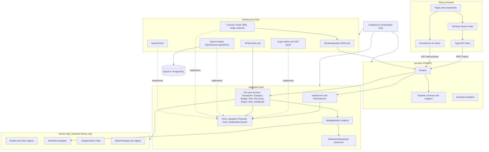
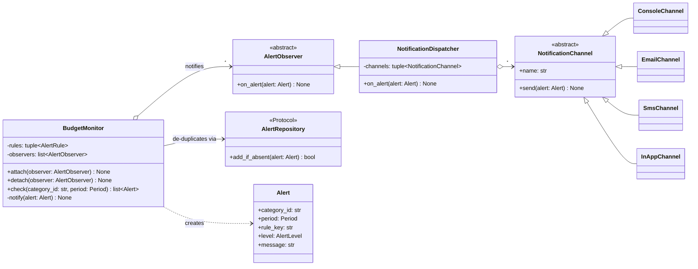
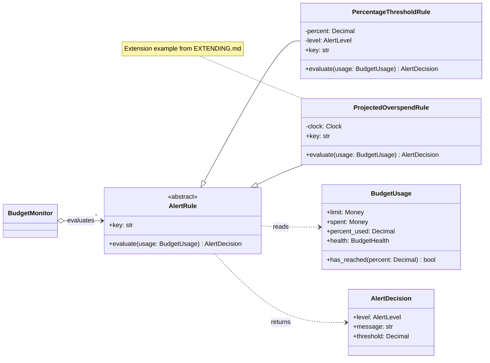
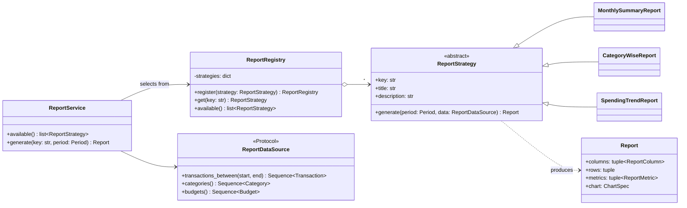
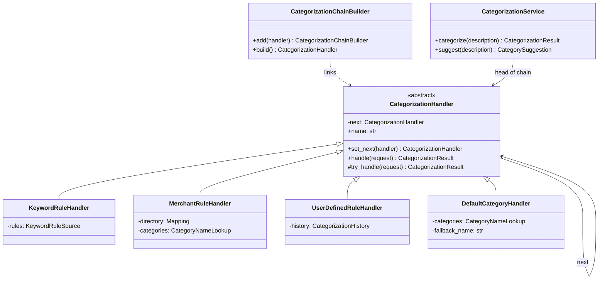
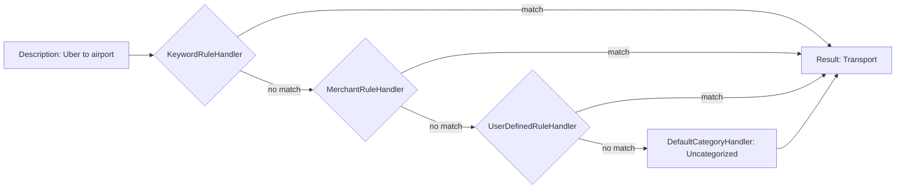
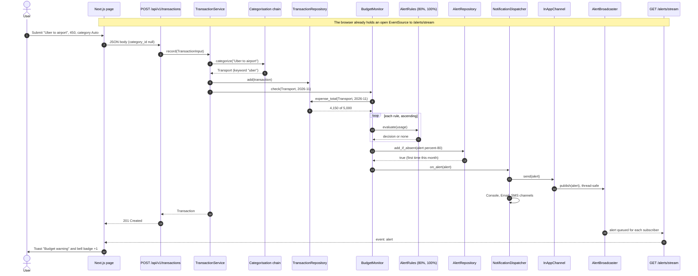
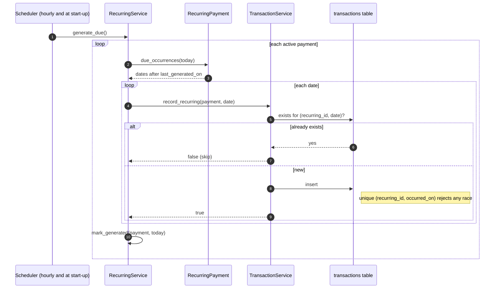
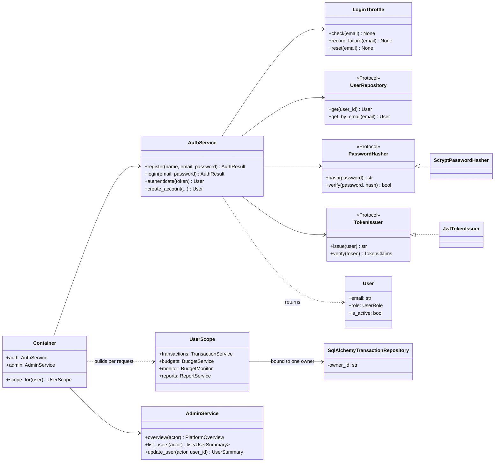
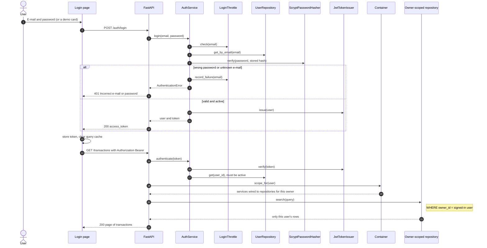

# UML diagrams

All diagrams are Mermaid and render directly on GitHub, GitLab and in VS Code (with a Mermaid extension).

## 1. Architecture (components and dependencies)

Arrows show "depends on". Every arrow points inwards towards the domain, except the composition root, which knows everything because its job is to wire it.

## 2. Observer: budget alerts

## 3. Strategy: alert rules

`BudgetMonitor` is the context. Rules are configured from `ALERT_THRESHOLDS` in the composition root.

## 4. Strategy: reports

## 5. Chain of Responsibility: categorisation

Runtime chain (default `CATEGORIZATION_ORDER`):

## 6. Sequence: add expense → categorise → budget check → alert → UI

## 7. Sequence: idempotent recurring generation

## 8. Accounts and per-user scoping

## 9. Sequence: sign in, then a scoped request

